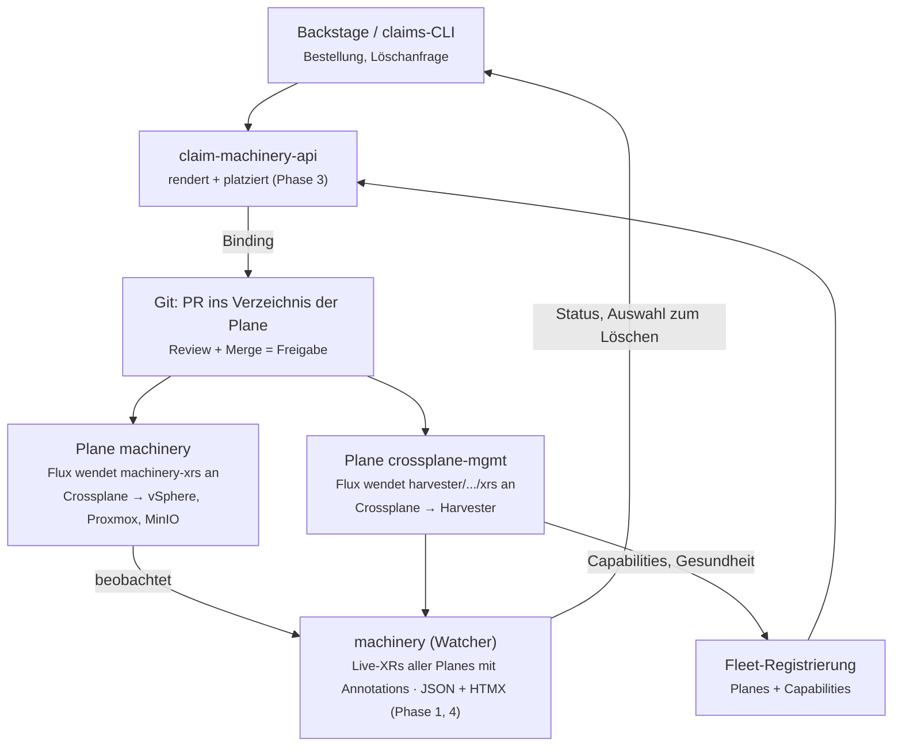
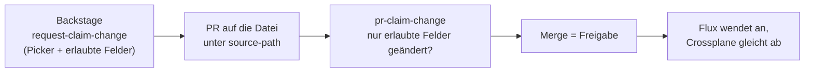
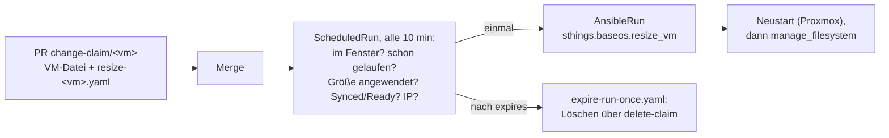

# Claim Scheduler – Design

Stand: 2026-10-24 · Status: Entwurf · Living copy: [Claude Doc](https://claude.ai/artifact/Nc43La1Bm8BYTxiKbViiJo)

## Ziel und Ist-Zustand

Ein Claim soll künftig auf der Management Plane landen, die ihn am besten ausführen kann, statt fest in einem Git-Verzeichnis. Die Entscheidung trifft ein Scheduler vor dem Commit; Git bleibt die Quelle der Wahrheit.

**Heute** ist die Platzierung fest verdrahtet:

- Backstage `create-vm` und `create-cluster-stack` schreiben immer nach `clusters/labda/vsphere/machinery-xrs` und setzen `stuttgart-things.com/management-cluster: machinery`.
- Harvester-Claims laufen auf einer zweiten Plane, `crossplane-mgmt`, mit eigenem Verzeichnis (`harvester/clusters/crossplane-mgmt/xrs`). Welche Plane gilt, entscheidet der Mensch über die Wahl der Vorlage oder des Profils.
- claim-machinery-api rendert nur; wohin das Ergebnis geht, weiß sie nicht.

**Bereits erledigt (Phase 0):** Jedes XR in `machinery-xrs` trägt `stuttgart-things.com/source-path` mit seinem Dateipfad; `hack/check-xr-source-path.py` prüft das in der CI ([stuttgart-things#4073](https://github.com/stuttgart-things/stuttgart-things/pull/4073)).

**Ziele**

1. Für einen neuen Claim die passende Plane automatisch bestimmen (filtern, bewerten, zuweisen).
2. Die Zuweisung als normaler GitOps-PR in das Verzeichnis dieser Plane.
3. Claims über alle Planes hinweg sehen und gezielt löschen können.

**Nicht-Ziele (vorerst)**

- Automatisches Umverteilen laufender Workloads. Migration ist ein späterer, manueller Schritt (siehe [Migration](#migration-später)).
- Ein eigener Ausführungsweg neben Flux: der Scheduler wendet nichts direkt auf eine Plane an.

## Begriffe

| Begriff | Bedeutung | Beispiel heute |
| --- | --- | --- |
| Management Plane | Cluster mit Crossplane, der XRs ausführt; hat ein GitOps-Verzeichnis, das Flux anwendet | `machinery` (`machinery-xrs`), `crossplane-mgmt` |
| Fleet | Alle Management Planes, die der Scheduler kennt | machinery + crossplane-mgmt |
| ClaimRequest | Der Wunsch eines Nutzers: welches XR (Kind + Spec) und welche Randbedingungen. Noch kein XR | „NativeVsphereVM, Lab labda, Größe large“ |
| Placement | Entscheidung des Schedulers: welche Plane, mit Begründung | machinery, weil `vspherevm-labda` dort existiert |
| Binding | Umsetzung des Placements: Datei im Verzeichnis der Plane, als PR | `machinery-xrs/<name>.yaml` |
| Capability | Was eine Plane kann: installierte XRDs und Versionen, EnvironmentConfigs, ProviderConfigs | `vspherevm:v0.13.0`, `proxmoxvm-labul` |

## Architektur

Der Scheduler entscheidet und schreibt einen PR; ausgeführt wird ausschließlich durch Flux und Crossplane auf der gewählten Plane.

Backstage oder die claims-CLI schicken einen Request an claim-machinery-api. Die API rendert, liest die Fähigkeiten der Planes aus der Fleet-Registrierung und legt den PR im Verzeichnis der gewählten Plane an. `machinery` beobachtet die XRs aller Planes und liefert Status und die Auswahl für das Löschen zurück an Backstage.

## Leitfragen

**Ist das ein Kubernetes-Operator plus kleine HTMX-GUI?** Ja, als Zielbild, aber nicht als erster Schritt. Die Platzierung selbst ist eine reine Funktion (Request + Fleet-Zustand → Plane) und passt zuerst als Schritt in claim-machinery-api, die ohnehin rendert. Ein Operator lohnt sich erst, wenn etwas dauerhaft abgeglichen werden muss: Status eines Requests verfolgen, Planes überwachen, später Migration. Die GUI gehört in `machinery`, das schon eine HTMX-Oberfläche hat, statt in ein drittes Frontend.

**Bekommt der Scheduler Requests statt echter XRs?** Ja, das ist der Kern des Designs. Ein `ClaimRequest` enthält Kind, Spec und Randbedingungen, aber er ist kein XR und wird nirgends von Crossplane verarbeitet. Erst das Binding erzeugt das echte XR, und zwar als Datei im Verzeichnis der gewählten Plane. So bleibt jedes XR genau einer Plane zugeordnet, und Git bleibt die einzige Quelle. Das entspricht dem Muster Pod → Scheduler → Binding in Kubernetes.

**kcp?** Nicht als Grundlage, aber als späterer Spike interessant.

- [kcp](https://github.com/kcp-dev/kcp) ist eine API-Steuerebene mit Workspaces pro Team, ohne eigene Workloads. Das frühere Multi-Cluster-Scheduling (TMC) ist nicht mehr Teil von kcp.
- Der Anschluss an echte Cluster läuft heute über den [api-syncagent](https://github.com/kcp-dev/api-syncagent): Er synchronisiert Objekte aus kcp-Workspaces auf einen Service-Cluster, wo zum Beispiel Crossplane sie verarbeitet, und meldet den Status zurück.
- Das löst Mandantenfähigkeit und Self-Service-APIs, aber keine Platzierung nach Fähigkeit oder Last: welcher Cluster ein Objekt bekommt, hängt an der API-Bindung, nicht an einem Scheduler.
- kcp wäre API-first, also nicht Git-first. Das widerspricht dem heutigen Prinzip „Datei zuerst“.

**Andere fertige Bausteine:** [Open Cluster Management](https://github.com/open-cluster-management-io/ocm) hat eine Placement-API mit Filtern und Bewertungen, die unserem Filter- und Scoring-Ansatz sehr nahe kommt. [Karmada](https://github.com/karmada-io/karmada) verteilt Ressourcen per Propagation Policy. Beide wenden Objekte direkt auf Cluster an statt über Git; sie dienen als Vorbild für das Datenmodell, nicht als Abhängigkeit.

## Fleet-Registrierung

Jede Plane meldet ihre Fähigkeiten selbst, abgeleitet aus dem, was im Cluster wirklich installiert ist, statt aus einer Liste, die jemand pflegt.

| Angabe | Quelle auf der Plane | Wozu |
| --- | --- | --- |
| Name, Lab, GitOps-Verzeichnis | statisch, aus der Registrierung | Binding-Ziel |
| Installierte XRDs + Configuration-Versionen | `configurations.pkg.crossplane.io`, `xrd` | Filter: kann diesen Kind |
| EnvironmentConfigs | `environmentconfigs` | Filter: kennt dieses Lab/Environment |
| ProviderConfigs | `clusterproviderconfigs` u. a. | Filter: erreicht die Ziel-Infrastruktur |
| Gesundheit | Crossplane- und Provider-Pods, XRs mit `Ready=False` | Filter und Score |
| Last | Zahl der XRs je Kind | Score |

**Woher die Daten kommen:** `machinery` beobachtet heute schon XRs eines Clusters. Der naheliegende Weg ist ein kleiner Exporter pro Plane (oder machinery im Multi-Cluster-Modus), der diese Angaben als JSON ausliefert. Das XRD `ManagementPlane` beschreibt bereits Planes, die machinery baut (`profile`, `crossplaneVersion`); es ist der Ort für die statischen Angaben.

**Registrierung:** Eine Datei pro Plane im Repo, zum Beispiel `fleet/planes/machinery.yaml` mit Name, Lab, GitOps-Verzeichnis und Endpoint des Exporters. Neue Plane = neue Datei, per PR.

## Filter und Bewertung

Zuerst fallen alle Planes weg, die den Claim nicht ausführen können; unter den übrigen gewinnt die mit der höchsten Punktzahl. Bleibt keine Plane übrig, scheitert der Request mit Begründung, statt irgendwo zu landen.

**Filter (alle müssen erfüllt sein)**

1. Das XRD für den Kind ist installiert, in einer Version, die der Request braucht.
2. Die angefragte EnvironmentConfig existiert (`vspherevm-labda`, `proxmoxvm-labul`, `harvestervm-defaults` …).
3. Eine ProviderConfig zur Ziel-Infrastruktur ist vorhanden.
4. Die Plane ist gesund: Crossplane und die betroffenen Provider laufen.
5. Feste Regeln aus dem Request passen, etwa `stage: prod` nur auf Planes mit diesem Label.

**Bewertung (Startwerte, später justieren)**

| Kriterium | Punkte | Begründung |
| --- | --- | --- |
| Plane im selben Lab wie die Ziel-Infrastruktur | +50 | kurze Wege, weniger Abhängigkeit vom Netz zwischen Labs |
| Zugehöriges XR liegt schon dort (Affinität) | +30 | was zu einem ClusterStack gehört, bleibt zusammen |
| Wenig XRs dieses Kinds | bis +20 | einfache Lastverteilung |
| Plane mit offenen `Ready=False`-XRs | −20 | erst aufräumen, dann Neues |

**Beispiel:** Ein `NativeProxmoxVM`-Request für LabUL. Nur machinery hat `proxmoxvm-labul`, also bleibt nur machinery übrig, ohne Punktvergleich. Ein `HarvesterVM`-Request landet aus demselben Grund auf crossplane-mgmt. Die Punkte entscheiden erst, wenn zwei Planes denselben Kind und dasselbe Environment können.

**Nachvollziehbarkeit:** Das Placement schreibt seine Begründung mit (welche Planes gefiltert wurden und warum, die Punkte der übrigen) in die PR-Beschreibung.

## Binding

Das Binding ist ein normaler PR: Der Scheduler schreibt das gerenderte XR in das GitOps-Verzeichnis der gewählten Plane, Flux wendet es nach dem Merge an. Der Scheduler hat keinen Schreibzugriff auf eine Plane.

1. claim-machinery-api rendert das XR (wie heute).
2. Der Scheduler hängt die Annotations an, die die Zuordnung festhalten:
    - `stuttgart-things.com/management-cluster: <plane>`
    - `stuttgart-things.com/source-path: <verzeichnis der plane>/<datei>.yaml`
    - `stuttgart-things.com/placement: <kurzbegründung>` (neu, optional)
3. Die Datei kommt nach `<verzeichnis der plane>/<datei>.yaml`, die `kustomization.yaml` dort bekommt den Eintrag.
4. PR mit der Begründung aus dem Placement; Review und Merge wie heute.

**Pfade pro Plane:**

| Plane | Repo | Verzeichnis |
| --- | --- | --- |
| machinery | stuttgart-things/stuttgart-things | `clusters/labda/vsphere/machinery-xrs` |
| crossplane-mgmt | stuttgart-things/harvester | `clusters/crossplane-mgmt/xrs/...` |

Die Prüfung `hack/check-xr-source-path.py` deckt heute nur das stuttgart-things-Repo ab; für crossplane-mgmt braucht sie ein Gegenstück im harvester-Repo.

## Löschen (Teil C)

Gelöscht wird über eine neue Backstage-Vorlage `request-claim-deletion` nach dem Muster von `request-vm-deletion`: Die Anfrage ist ein PR, der Merge ist die Freigabe, ein Dapr-Worker führt aus. Löschen ist damit immer eine ausdrückliche Anfrage und nie die Nebenwirkung einer entfernten Datei.

1. Nutzer wählt in Backstage das XR. Die Auswahl kommt aus den Live-XRs der Planes (machinery), angezeigt mit Kind, Name, Plane und `source-path`.
2. Die Vorlage rendert eine `BackstageTemplateRun` und öffnet damit einen PR. Inhalt: Kind, Name, Namespace, Plane, `source-path`, Grund, wer angefragt hat.
3. Ein Platform-Engineer merged den PR; Flux wendet die Run an.
4. Der Dapr-Worker startet die Vorlage `delete-claim`. Sie öffnet einen zweiten PR auf dem Branch `delete-claim/<name>`: Datei unter `source-path` entfernen, Eintrag aus der `kustomization.yaml` streichen. `pr-claim-delete.yaml` prüft, dass der PR nur das tut; ist die Prüfung grün, merged der Worker.
5. Nach dessen Merge wartet `delete-claim-xr.yaml`, bis Flux den Merge-Commit angewendet hat, und löscht dann das XR (`kubectl delete --wait`).
6. Später: Status und Ergebnis an Homerun.

**Stand (2026-10-25):** live. Erster echter Durchlauf mit der Wegwerf-VM `claim-test1-vm`: Picker, beide PRs und der Merge durch den Worker liefen durch. Das Löschen des XR scheiterte vorher an einem mehrdeutigen `gitrepository` (auf machinery gibt es auch `gitrepositories.sops.stuttgart-things.com`). Der Fix ist stuttgart-things#4093. Fehlgeschlagene Läufe lassen sich jetzt per PR-Nummer wiederholen (`gh workflow run delete-claim-xr.yaml -f pr=<n>`).

Abweichungen vom ersten Entwurf:

- Das XR löscht ein GitHub-Workflow, nicht der Worker. Er hat die SOPS-Kubeconfig der Plane ohnehin, und der Worker braucht so keinen Zugriff auf machinery.
- `ClusterStack` ist vorerst ausgeschlossen, im Picker (`excludeKinds`) und in `hack/claim-deletion.py` (`REFUSED`). Das Abschalten der Platform vor dem Löschen kommt später.
- `request-claim-deletion` ist für alle Entwickler offen. Die Freigabe ist der Merge durch das Platform-Team; `delete-claim` selbst bleibt Platform-Team-only.
- Erlaubte Verzeichnisse stehen fest in `hack/claim-deletion.py` (`PLANES`), heute nur `clusters/labda/vsphere/machinery-xrs`. Eine neue Plane braucht dort einen Eintrag mit Kubeconfig und Kustomization.
- Bei einem `MinioBucket` bleibt der Bucket mit seinem Inhalt stehen (`deletionPolicy: Orphan`).

**Warum diese Reihenfolge:** `machinery-xrs` pruned nicht. Wird das XR vor der Datei gelöscht, legt der nächste Abgleich es wieder an (so wurden labda-rancher-1/2 am 2026-10-02 neu gebaut).

**Was es braucht:**

- `machinery`: JSON-Endpunkt mit Annotations (`source-path`, `management-cluster`).
- Backstage: Picker für Live-XRs, über den Proxy auf `machinery`.
- Worker: Funktion `delete-claim` mit den Schritten 4 bis 6.
- Danach: flux-Komponente `machinery-registry-api` und den Proxy `/machinery-registry` entfernen.

Umgesetzt in machinery#106 (v1.15.0), sthings-backstage#193 (v1.19.0), flux#850 (v1.192.0) und stuttgart-things#4078 und #4093.

## Ändern (Teil D)

Ein bestellter Claim soll sich nachträglich ändern lassen, etwa eine VM von `medium` auf `large`. Der Weg ist derselbe wie beim Löschen: auswählen, PR auf die Datei, der Merge ist die Freigabe. Er ist kürzer, weil Flux die geänderte Datei einfach anwendet; einen zweiten Schritt auf dem Cluster gibt es nicht.

**Kein freies Bearbeiten.** Nicht jedes Feld ist harmlos:

- CPU und RAM einer VM gehen meist nur mit Neustart.
- Eine Disk lässt sich nur vergrößern.
- `vm.name`, Template, Netzwerk oder `environmentConfig` bauen die VM im schlimmsten Fall neu oder lassen den Provider hängen. Ein Beispiel für Letzteres ist der MinIO-Username, den der Provider nicht ändern lässt (stuttgart-things#4081).

Darum gibt es pro Kind eine Liste erlaubter Änderungen, als Code neben `hack/claim-deletion.py`:

| Kind | Erlaubt | Regel |
| --- | --- | --- |
| NativeProxmoxVM, NativeVsphereVM | Größe (`vm.cpu`, `vm.memory`) | nur Werte aus den Größen der Bestellvorlage; Hinweis auf Neustart |
| NativeProxmoxVM, NativeVsphereVM | `vm.disk` | nur größer |
| ScheduledRun | Zeitplan, `suspend` | gültiger Cron-Ausdruck |
| ClusterStack, MinioBucket | vorerst nichts | |

**Ablauf:**

1. Picker wie beim Löschen; die Vorlage zeigt nur die erlaubten Felder des gewählten Kinds, vorbelegt mit den aktuellen Werten aus machinery.
2. Ein Skript patcht die Datei unter `source-path`, mit einem YAML-Parser, der Kommentare erhält, und öffnet den PR.
3. `pr-claim-change.yaml` vergleicht alte und neue Datei und lehnt jede Änderung außerhalb der Liste ab.
4. Merge, Flux, Crossplane. Ob die Änderung angekommen ist, zeigt machinery am Status des XR.

Hier braucht es weder Dapr-Worker noch kubectl: Der PR ist schon die ganze Änderung. Die Vorlage stößt `dispatch-change-claim.yaml` direkt an (`github:actions:dispatch`).

**Stand (2026-10-25):** live für die VM-Größe (stuttgart-things#4096). Erster echter Durchlauf mit `cutover3-vm`, medium → large: Der PR #4103 änderte nur cpu, memory und disk. Nach dem Merge zeigte Proxmox 8 CPU, 16384 MiB und 100 GB, ohne dass die VM neu gebaut wurde.

### Im Gast ankommen: Einmal-Lauf

Was Crossplane an der VM ändert, kommt nicht vollständig im Gast an. Auf Proxmox wirken zusätzliche CPU und zusätzlicher RAM erst nach dem nächsten Neustart (`rebootAfterUpdate: false`). Eine größere Disk steckt bei beiden Providern noch nicht in Partition, LVM und Dateisystemen. Deshalb kann eine Größenänderung einen **Einmal-Lauf** mitbringen (stuttgart-things#4106):

- **Wann:**
  - nach Feierabend: das nächste 19–22 Uhr Europe/Berlin, die Voreinstellung
  - sofort nach dem Merge
  - ab einem gewählten Zeitpunkt
  - oder gar nicht

  Das Fenster steht als `not-before`/`expires` in UTC am ScheduledRun. Wird der PR erst nach dem Fenster gemergt, passiert im Gast nichts.
- **Nur einmal:** Der Name des AnsibleRun steht vorher fest (`resize-<vm>-<Start>`). Existiert es, beendet sich jeder weitere Tick.
- **Erst wenn die Größe angekommen ist:** Das XR muss die neue Größe tragen, und jede komponierte Ressource muss `Synced` und `Ready` bei ihrer aktuellen `generation` sein.
- **Kein Bauen von Hand:** Die Datei rendert `hack/claim-change.py` aus `hack/claim-change-run.yaml`. `pr-claim-change.yaml` rendert sie nach und lehnt jede Abweichung ab.
- **Aufräumen:** Abgelaufene Läufe löscht nachts `expire-run-once.yaml`, über den Lösch-Weg aus Teil C: zuerst die Datei, dann das Objekt, gemergt erst bei grüner Prüfung.

**Später sauberer:** Die Bestellung hält fest, aus welcher Vorlage und mit welchen Parametern sie entstanden ist (Annotation `stuttgart-things.com/order`). Eine Änderung rendert dann über claim-machinery-api neu, statt YAML zu patchen. Das passt zu Phase 3, in der claim-machinery-api ohnehin das Placement übernimmt.

## Migration (später)

Umziehen heißt: Die alte Plane lässt die erzeugten Ressourcen los, die neue übernimmt sie, ohne dass VM oder Bucket neu gebaut werden. Das kommt erst nach den Phasen 1 bis 3 und zunächst nur als manuelles „Drain“ einer Plane.

1. Alte Plane: erzeugte Ressourcen auf `managementPolicies: ["Observe"]` bzw. `deletionPolicy: Orphan` setzen.
2. Neue Plane: XR mit denselben `crossplane.io/external-name`-Werten anlegen (als PR in deren Verzeichnis).
3. Warten, bis das XR dort `Ready` und `Synced` ist.
4. Altes XR mit Orphan löschen, Datei per `git mv` verschieben, Annotations anpassen.

Voraussetzung: Die Compositions vergeben externe Namen deterministisch.

| Kind | Machbarkeit | Grund |
| --- | --- | --- |
| NativeVsphereVM, NativeProxmoxVM | gut | VM-ID ist importierbar |
| MinioBucket | gut | Bucket-Name ist die externe ID |
| ScheduledRun | einfach | neu anlegen, alte löschen; keine externe Ressource |
| AnsibleRun | nicht umziehen | einmaliger Lauf, nur als erledigt übernehmen |
| ClusterStack | schwer | Usages, Vault- und Argo-CD-Registrierung, viele Unterobjekte |
| OpenTofu-basierte XRs | schwer | der Tofu-State muss mitwandern |

Freischalten pro XR mit `stuttgart-things.com/movable: "true"`; automatisches Umverteilen erst, wenn Drain zuverlässig läuft.

## Phasenplan

Jede Phase liefert für sich etwas Nutzbares; die nächste beginnt erst, wenn die vorige läuft.

```mermaid
flowchart TB
    p0["<b>Phase 0 · source-path-Annotations (erledigt)</b><br/>Jedes XR in machinery-xrs nennt seine Datei; die CI prüft das (stuttgart-things#4073)<br/><i>Ergebnis: Objekt und Datei sind eindeutig verbunden</i>"]
    p1["<b>Phase 1 · Löschen über Backstage (live)</b><br/>JSON-Endpunkt in machinery, Picker auf Live-XRs, Vorlage request-claim-deletion, Worker delete-claim<br/><i>Ergebnis: Claims auf machinery per PR löschbar; Reste der registry-api entfernt</i>"]
    p1b["<b>Phase 1b · Ändern über Backstage (live: VM-Größe)</b><br/>Vorlage request-claim-change mit erlaubten Feldern pro Kind, PR-Prüfung pr-claim-change; Einmal-Lauf für Neustart und Dateisysteme<br/><i>Ergebnis: VM-Größe per PR änderbar, im Gast angewendet zur gewünschten Zeit</i>"]
    p2["<b>Phase 2 · Fleet-Registrierung</b><br/>Eine Datei pro Plane; ein Exporter meldet XRDs, EnvironmentConfigs, ProviderConfigs, Gesundheit<br/><i>Ergebnis: eine Liste aller Planes mit dem, was sie können</i>"]
    p3["<b>Phase 3 · Placement beim Bestellen</b><br/>Filter und Bewertung als Schritt in claim-machinery-api; Backstage und claims nutzen ihn<br/><i>Ergebnis: neue Claims landen auf der passenden Plane, mit Begründung im PR</i>"]
    p4["<b>Phase 4 · Operator und GUI</b><br/>CRD ClaimRequest mit Status, ein Operator gleicht ab; Ansicht in der HTMX-Oberfläche von machinery<br/><i>Ergebnis: Requests über alle Planes verfolgbar, nicht nur als PR</i>"]
    p5["<b>Phase 5 · Drain und Migration</b><br/>Manuelles Leerräumen einer Plane, nur für Kinds mit importierbaren IDs (movable: true)<br/><i>Ergebnis: Plane austauschbar, ohne VMs neu zu bauen; Automatik erst danach</i>"]
    p0 --> p1 --> p1b --> p2 --> p3 --> p4 --> p5
    style p0 stroke:#2e7d32,stroke-width:2px
    style p1 stroke:#2e7d32,stroke-width:2px
```

Phase 1 baut auf Phase 0 auf und braucht noch keinen Scheduler; der Operator kommt erst in Phase 4, wenn Requests einen eigenen Status brauchen.

## Offene Fragen

- [ ] Wo lebt die Fleet-Registrierung: eigenes Verzeichnis `fleet/` im stuttgart-things-Repo oder als `ManagementPlane`-Objekte auf machinery?
- [ ] machinery im Multi-Cluster-Modus oder ein Exporter pro Plane? Ersteres braucht Kubeconfigs aller Planes an einer Stelle.
- [ ] crossplane-mgmt liegt im harvester-Repo: bleibt das so, oder ziehen alle Plane-Verzeichnisse in ein Repo?
- [ ] Wer löscht auf crossplane-mgmt: derselbe Dapr-Worker oder ein eigener?
- [x] Ändern: Größenname oder cpu/memory? Im Formular wird der Größenname gewählt, in der Datei stehen cpu/memory/disk aus der Größentabelle von create-vm. Die PR-Prüfung lässt nur Paare aus dieser Tabelle zu.
- [ ] ClusterStack löschen: wann, und mit welchem Ablauf zum Abschalten der Platform?
- [ ] Brauchen Requests einen eigenen Status (CRD `ClaimRequest`), oder reicht der PR als Status bis zur Operator-Phase?
